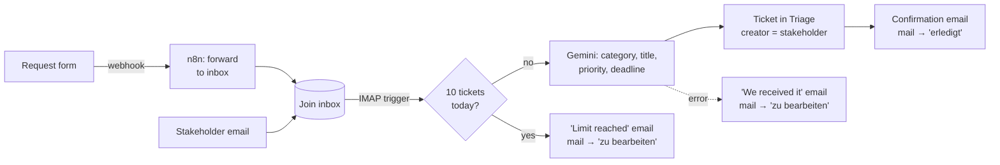

# Join

A Kanban project management tool built as a Multi-Page Application (MPA) with vanilla JavaScript and Firebase — originally developed as an agile group project at Developer Akademie, then extended solo with the **AI Issue Collector**: stakeholders send feature requests and bug reports by email, and an n8n workflow turns them into tickets on the board.

## Features

- Sign up and log in with email and password (Firebase Authentication), or log in as a guest
- Kanban board with the columns Triage, To Do, In Progress, Awaiting Feedback and Done — every new task lands in Triage, the backlog for prioritising
- Create, edit and delete tasks — with category, priority, due date, assignees and subtasks
- Drag & drop between columns (desktop), "Move to" menu (mobile)
- **Live updates:** changes by other users show up instantly on every open page, without a reload
- Task search by title and description
- Contact management (add, edit, delete — deleting a contact also unassigns it from all tasks)
- Summary dashboard with task counts, next urgent deadline and a time-based greeting
- Responsive from 320px, mobile-first
- Help page, Legal Notice and Privacy Policy
- Every task shows its creator — team member or external stakeholder — and AI-generated tickets are marked as such

## Issue Collector

Stakeholders don't need a Join account. They pick **"Are you a stakeholder?"** on the start page and either fill in the request form or email the Join inbox directly. Both end up in the same n8n pipeline:



- **AI analysis** — Gemini returns a fixed JSON schema: category (User Story, Technical Task or Bug Report), a short title, a summary, the priority (from words like "urgent" or "nice to have") and a deadline if the email mentions one
- **Daily limit** — at most 10 AI tickets per day, as a cost airbag for the AI API. The request page shows the live count ("3 of 10"); after the limit, requests are still accepted and reviewed by the team manually
- **Status emails** — when the team moves a stakeholder's ticket to another column, n8n emails them. It waits 5 minutes first and only sends if the ticket is still in a new column, so dragging a card back and forth sends nothing
- **Error handling** — if the AI or the database fails, the email goes to the "zu bearbeiten" folder and the sender gets a "we received it" reply. Auto-replies and bounces are never answered, so two mailboxes can't reply to each other forever
- **Workflows in the repo** — [n8n/workflows/](n8n/workflows/) holds the three workflows as JSON; [n8n/README.md](n8n/README.md) explains how to run them

## Demo

**As a stakeholder**
1. Open the app and choose **"Are you a stakeholder?" → Create request**. The page shows how many of today's 10 AI tickets are left.
2. Send a request through the form — or write an email to the address shown on the page. Try something like: *"We need a PDF export of all tasks by the end of next month, it's quite urgent."*
3. Within about a minute you get a confirmation email with the ticket title, priority and deadline the AI picked.

**As a team member**
1. Back on the start page, choose **Member log in → Guest Log in**.
2. Open the **Board**: the new ticket is in Triage, marked "AI-generated ticket". Open it to see the stakeholder as its external creator.
3. Drag the ticket to **To Do** and leave it there. About 5 minutes later, the stakeholder gets an email that it was moved.

> The pipeline needs a running n8n instance. Until it is deployed, run it locally as described in [n8n/README.md](n8n/README.md).

## Tech Stack

- HTML, CSS, JavaScript (ES modules, ES2022 classes) — no framework, no build step
- Firebase Authentication (email/password + anonymous guest login)
- Firebase Realtime Database via the Firebase JS SDK, loaded from the gstatic CDN
- n8n (self-hosted with Docker) with Google Gemini for the Issue Collector; Gmail via IMAP/SMTP as the inbox

## Getting Started

The app runs straight from the repository, but it has to be **served over HTTP** — ES modules do not load from `file://`.

1. Clone the repository:
   ```bash
   git clone https://github.com/AngeloDevLab/join-3187.git
   ```
2. Serve the project root with any static server, e.g. the VS Code *Live Server* extension, or:
   ```bash
   npx serve .
   ```
3. Open `index.html` through that server, then log in as a guest or create an account.

The repository is already connected to its Firebase project. To run it against your own project, follow [docs/database-setup.md](docs/database-setup.md).

## Project Structure

```
join/
├── index.html              # Login / Sign up (entry point)
├── database.rules.json     # Realtime Database security rules
├── public/                 # Static files: fonts, icons
├── docs/                   # Architecture and setup documentation
├── n8n/                    # Issue Collector: docker-compose, exported workflows (JSON), setup guide
└── src/
    ├── styles/             # Design tokens (variables.css) and shared styles
    ├── components/         # UI used by several pages: Modal, Dropdown, navbar, toast, task-form/
    ├── services/           # Firebase setup, AuthService, live data stores, n8n webhooks
    ├── utils/              # Plain helper functions (validation, paths, auth guard, …)
    └── pages/              # One folder per page: its HTML, CSS, page script and page-only classes
        ├── auth/           #   used by index.html (role choice, login, sign up)
        ├── request/        #   public stakeholder page with the request form
        ├── summary/  board/  add-task/  contacts/  help/
        └── legal/          #   imprint.html + privacy.html
```

## Architecture

```
Page script (e.g. BoardPage)
  ├── authService     — who is logged in (Firebase Auth)
  └── taskStore / contactStore
        └── one realtime listener per collection (Firebase SDK, onValue)
              → every change re-renders the subscribed pages
```

- **Diagrams:** [docs/architecture.md](docs/architecture.md) — layers, page load and save flow (Mermaid, rendered by GitHub)
- **Auth:** [docs/auth.md](docs/auth.md) — login, signup, guest, route protection
- **Data:** [docs/data-layer.md](docs/data-layer.md) — stores, live updates, writes
- **Schema:** [docs/database-schema.md](docs/database-schema.md) — collections and fields

## Tech Decisions

- **Vanilla JS, no build step** — the project requirement; the Firebase SDK comes from its official CDN as ES modules, so no npm is needed
- **MPA over SPA** — every page is a static HTML file; markup lives in the HTML (`<template>` for repeated parts), JavaScript only adds behaviour
- **Classes where state and behaviour belong together** — services, stores, forms and page controllers are classes with native private members (`#field`); stateless helpers stay plain functions
- **Firebase Authentication** — real password check and session handling; guests get an anonymous account with the same rights as registered users
- **Realtime listeners instead of a request cache** — pages subscribe to the stores, so the board stays in sync across users and with external automations
- **Security rules** — only logged-in users (incl. guests) can read or write tasks and contacts; only the daily request count is public. n8n writes with a service account; see [database.rules.json](database.rules.json)
- **One pipeline for form and email** — the form doesn't write to the database; n8n mails it to the inbox, so limit, AI and replies exist only once
- **CSS custom properties** — all design tokens live in `src/styles/variables.css`
- **Avatar colors derived from the contact id** — the same contact always gets the same color everywhere

## Notes

- All users (incl. guests) share the same board and contacts
- The Firebase web config in `src/services/firebase-config.js` is public by design; access is protected by Authentication and the security rules — never commit service account keys or other credentials
- All n8n secrets (Gmail app password, Gemini API key, service account, `N8N_ENCRYPTION_KEY`) live in the n8n instance or the gitignored `n8n/.env`, never in the repo
- Tested in current Chrome, Firefox, Safari and Edge

## Team

| Name | Role |
|---|---|
| Christian M. | Developer |
| Mahad Yussuf Nur | Developer |
| Louis Juchem | Developer |
| Angelo Pietsch | Developer — Issue Collector extension (solo) |
