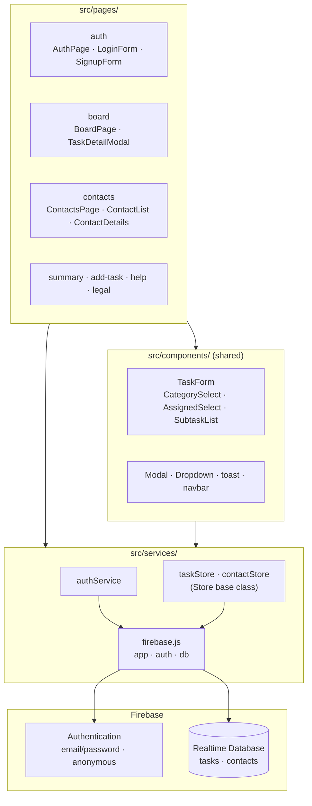
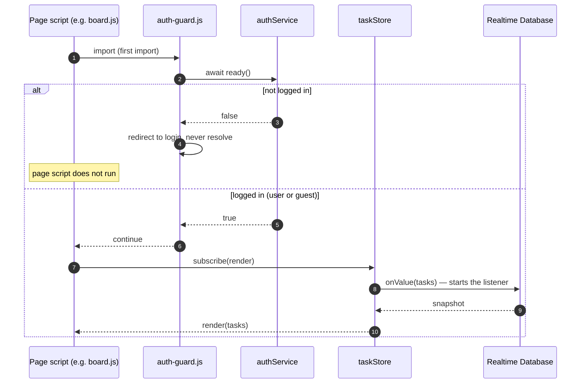
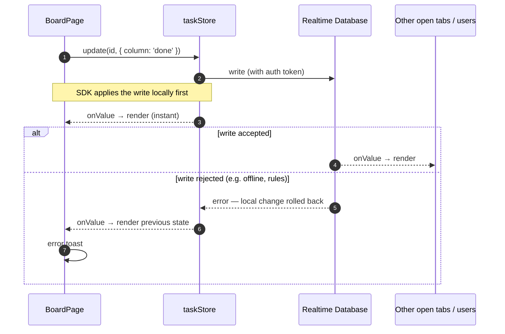

# Architecture

Join is a multi-page app: every page is a static HTML file with one page script. Shared logic sits in a few layers below the pages; only `src/services/` talks to Firebase.

## Layers

Rules that keep this shape:

- Pages and components never import the Firebase SDK; they only use `authService`, `taskStore` and `contactStore`.
- `src/components/` only holds what several pages use; page-only classes live in their page folder.

## Opening a protected page

## Saving a change

The page writes to the store and **does not re-render itself** — the listener does that, for this tab and for everyone else who has the board open.

External writers — such as the planned n8n issue collector — write to the database directly with a service account. Every open page picks the change up through the same listener, without any extra code.
